<p align="center">
  <a href="https://www.gitskins.com">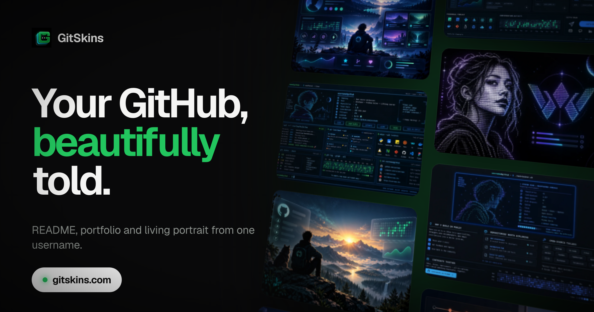</a>
</p>

<h1 align="center">Awesome GitSkins</h1>

<p align="center">
  A curated list of the best GitHub profile READMEs and portfolios made with <a href="https://www.gitskins.com">GitSkins</a>.
  <br>
  <a href="https://awesome.re"></a>
  
  <a href="CONTRIBUTING.md"></a>
</p>

Hundreds of developers have built their GitHub profile with GitSkins. These are some of our favourites, picked for design, personality and how well they tell the story of the person behind them. Use them for inspiration, or click through and build your own at [gitskins.com](https://www.gitskins.com).

## Contents

- [Neon & cyber](#neon--cyber)
- [Terminal & ASCII](#terminal--ascii)
- [Warm & bold](#warm--bold)
- [Light & minimal](#light--minimal)
- [Playful visuals](#playful-visuals)
- [Get featured](#get-featured)
- [Featured badge](#featured-badge)
- [Remove your profile](#remove-your-profile)

## Neon & cyber

Glowing cards, gradient borders and live stats.

<table>
  <tr>
    <td width="50%" valign="top">
      <a href="https://github.com/CScorza">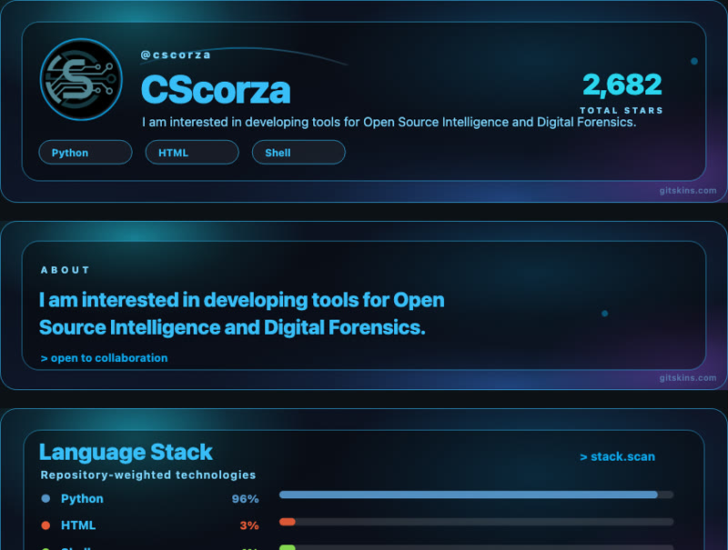</a>
      <br><b><a href="https://github.com/CScorza">@CScorza</a></b>
    </td>
    <td width="50%" valign="top">
      <a href="https://github.com/AnilYadav17">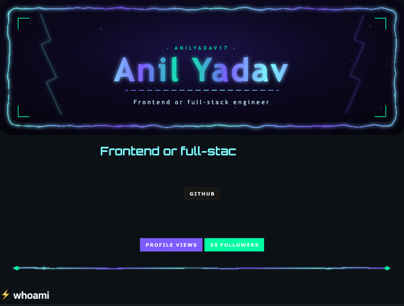</a>
      <br><b><a href="https://github.com/AnilYadav17">@AnilYadav17</a></b>
    </td>
  </tr>
  <tr>
    <td width="50%" valign="top">
      <a href="https://github.com/JihadZaidan">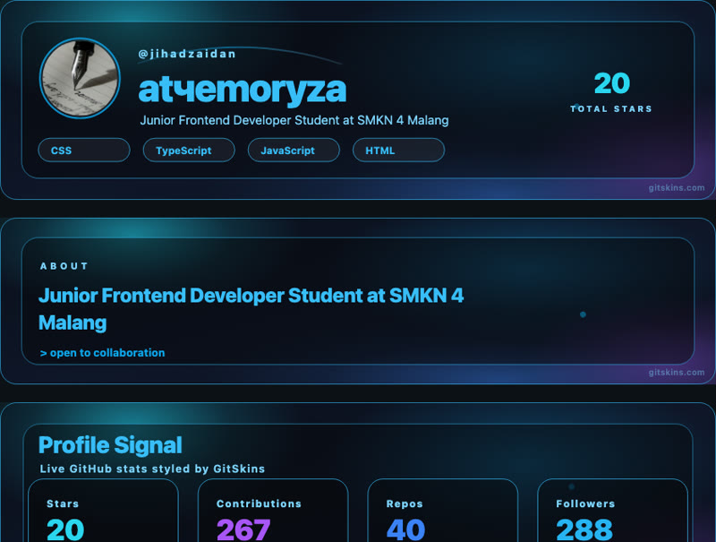</a>
      <br><b><a href="https://github.com/JihadZaidan">@JihadZaidan</a></b>
    </td>
    <td width="50%" valign="top">
      <a href="https://github.com/LeoGotardo">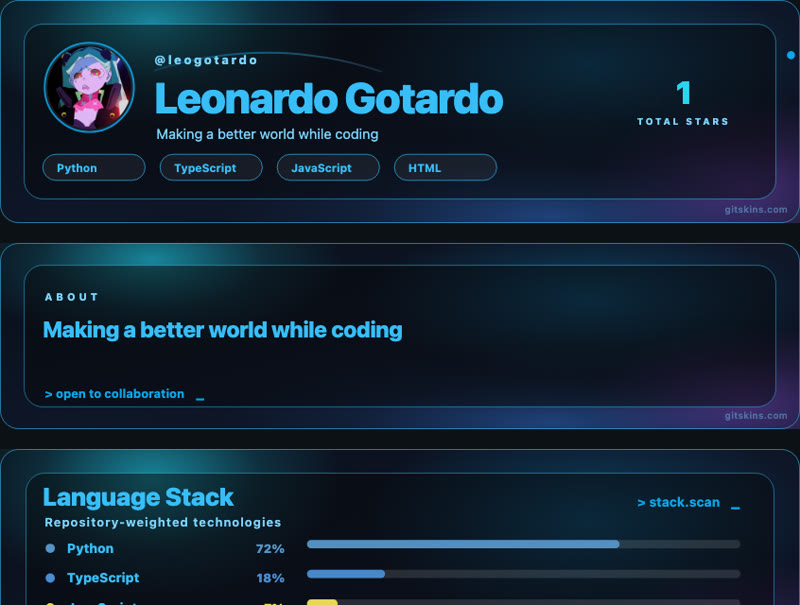</a>
      <br><b><a href="https://github.com/LeoGotardo">@LeoGotardo</a></b>
    </td>
  </tr>
  <tr>
    <td width="50%" valign="top">
      <a href="https://github.com/ahmed-tarek-2004">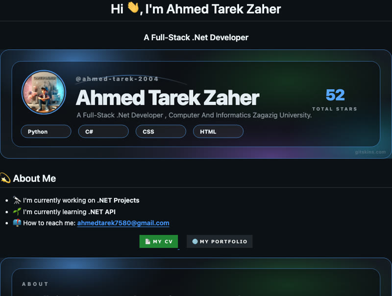</a>
      <br><b><a href="https://github.com/ahmed-tarek-2004">@ahmed-tarek-2004</a></b>
    </td>
    <td width="50%" valign="top">
      <a href="https://github.com/ariftsx">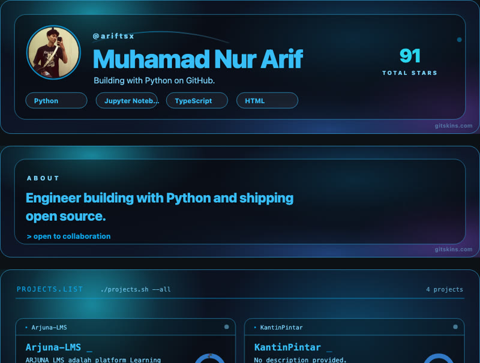</a>
      <br><b><a href="https://github.com/ariftsx">@ariftsx</a></b>
    </td>
  </tr>
  <tr>
    <td width="50%" valign="top">
      <a href="https://github.com/bala-2305">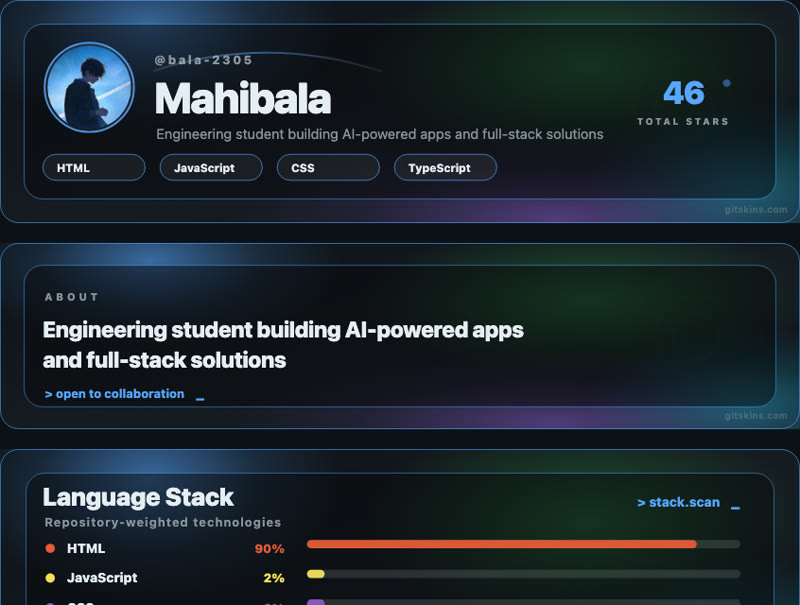</a>
      <br><b><a href="https://github.com/bala-2305">@bala-2305</a></b>
    </td>
    <td width="50%" valign="top">
      <a href="https://github.com/rodrigotoledo7">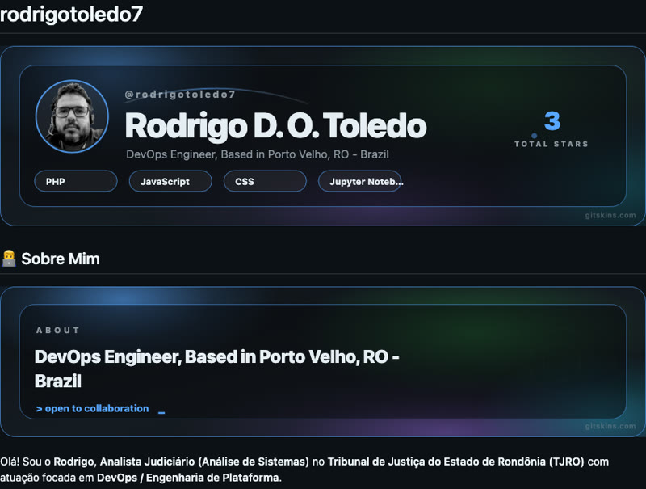</a>
      <br><b><a href="https://github.com/rodrigotoledo7">@rodrigotoledo7</a></b>
    </td>
  </tr>
</table>

## Terminal & ASCII

Shell prompts, ASCII art and `neofetch`-style intros.

<table>
  <tr>
    <td width="50%" valign="top">
      <a href="https://github.com/AIwolfie">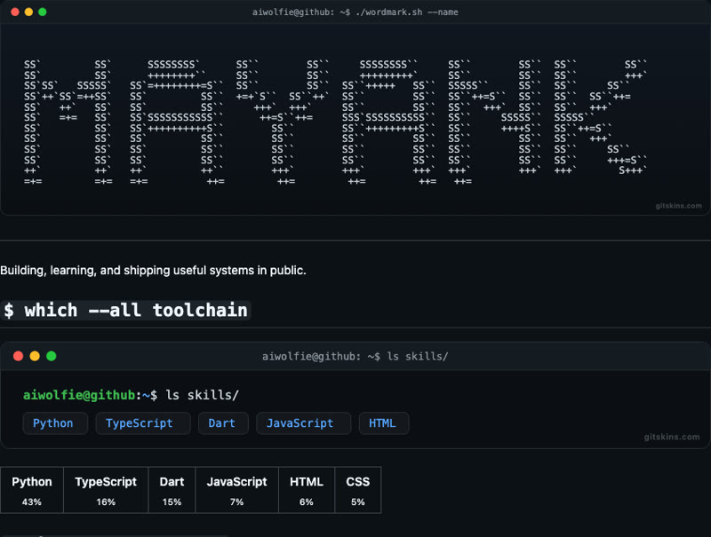</a>
      <br><b><a href="https://github.com/AIwolfie">@AIwolfie</a></b>
    </td>
    <td width="50%" valign="top">
      <a href="https://github.com/BrightProgrammer7">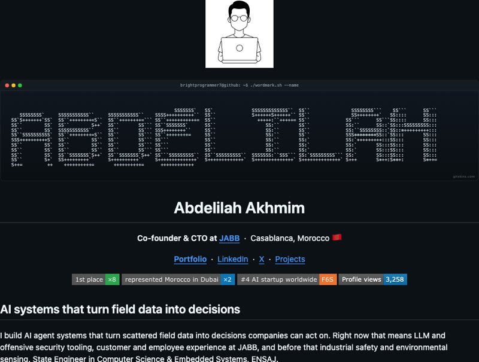</a>
      <br><b><a href="https://github.com/BrightProgrammer7">@BrightProgrammer7</a></b>
    </td>
  </tr>
  <tr>
    <td width="50%" valign="top">
      <a href="https://github.com/felipetruman">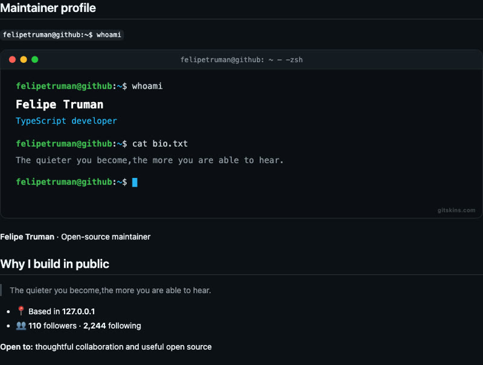</a>
      <br><b><a href="https://github.com/felipetruman">@felipetruman</a></b>
    </td>
    <td width="50%" valign="top">
      <a href="https://github.com/kshitij-shingare"></a>
      <br><b><a href="https://github.com/kshitij-shingare">@kshitij-shingare</a></b>
    </td>
  </tr>
  <tr>
    <td width="50%" valign="top">
      <a href="https://github.com/samimustafaa">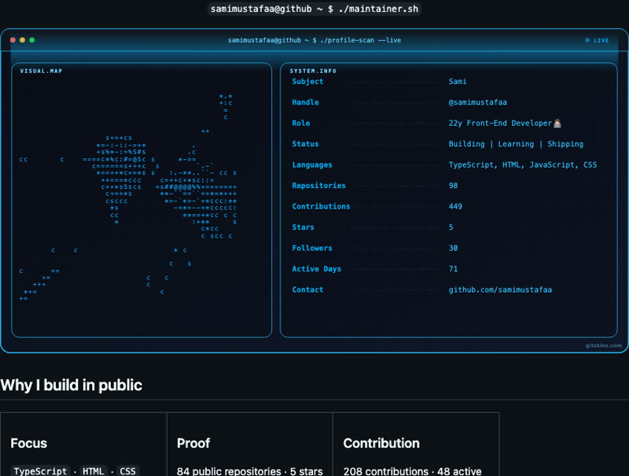</a>
      <br><b><a href="https://github.com/samimustafaa">@samimustafaa</a></b>
    </td>
    <td width="50%" valign="top">
      <a href="https://github.com/Abelmekonn">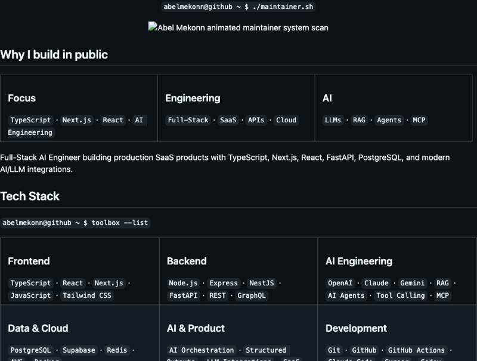</a>
      <br><b><a href="https://github.com/Abelmekonn">@Abelmekonn</a></b>
    </td>
  </tr>
</table>

## Warm & bold

Fiery palettes and big, confident hero cards.

<table>
  <tr>
    <td width="50%" valign="top">
      <a href="https://github.com/Bsdantas">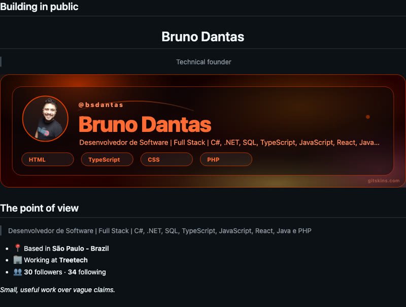</a>
      <br><b><a href="https://github.com/Bsdantas">@Bsdantas</a></b>
    </td>
    <td width="50%" valign="top">
      <a href="https://github.com/alsongarbuja">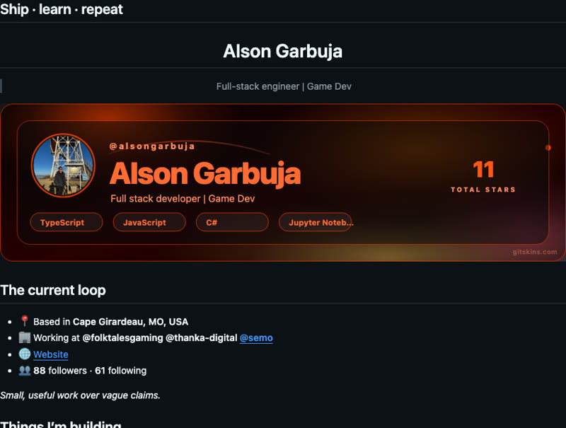</a>
      <br><b><a href="https://github.com/alsongarbuja">@alsongarbuja</a></b>
    </td>
  </tr>
  <tr>
    <td width="50%" valign="top">
      <a href="https://github.com/BuildByAman">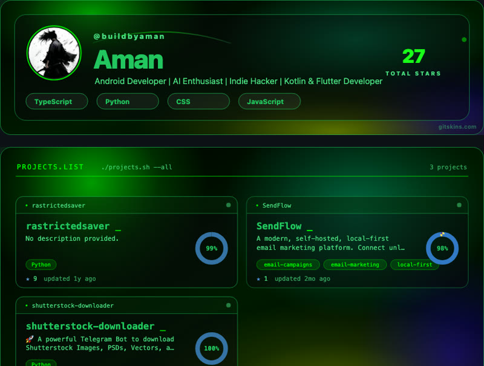</a>
      <br><b><a href="https://github.com/BuildByAman">@BuildByAman</a></b>
    </td>
    <td width="50%" valign="top">
      <a href="https://github.com/amar9elbeg">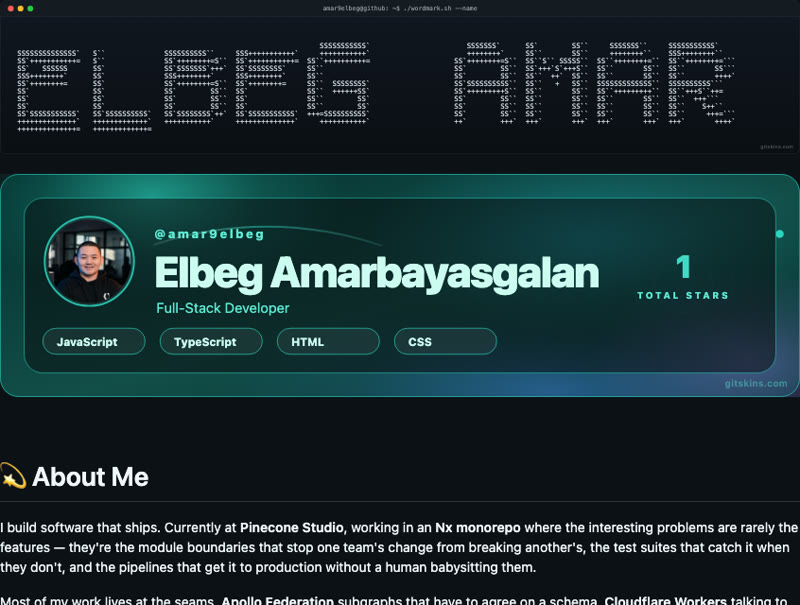</a>
      <br><b><a href="https://github.com/amar9elbeg">@amar9elbeg</a></b>
    </td>
  </tr>
  <tr>
    <td width="50%" valign="top">
      <a href="https://github.com/Herald-Flores">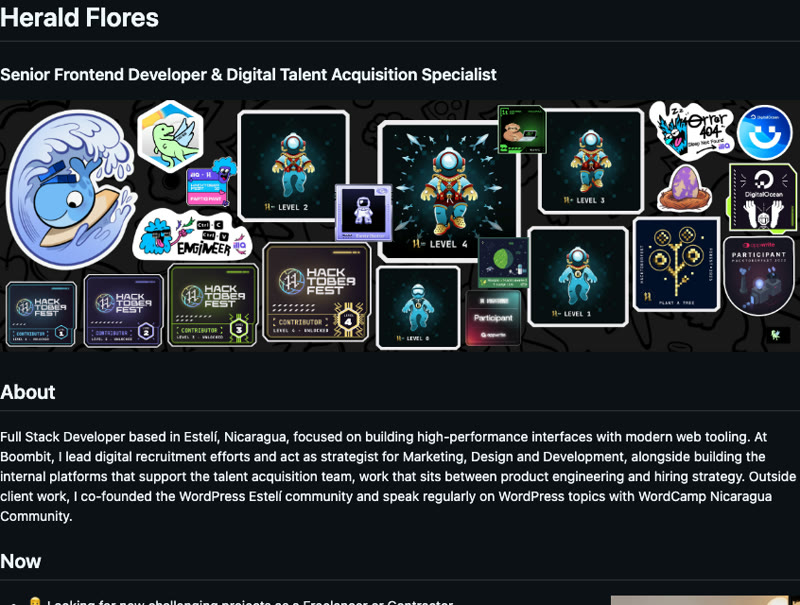</a>
      <br><b><a href="https://github.com/Herald-Flores">@Herald-Flores</a></b>
    </td>
    <td width="50%" valign="top">
      <a href="https://github.com/Rauliqbal">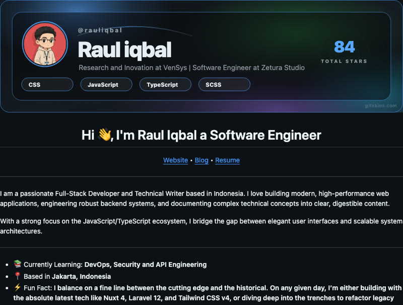</a>
      <br><b><a href="https://github.com/Rauliqbal">@Rauliqbal</a></b>
    </td>
  </tr>
</table>

## Light & minimal

Clean, bright layouts that read well in light mode.

<table>
  <tr>
    <td width="50%" valign="top">
      <a href="https://github.com/MathQnADEV">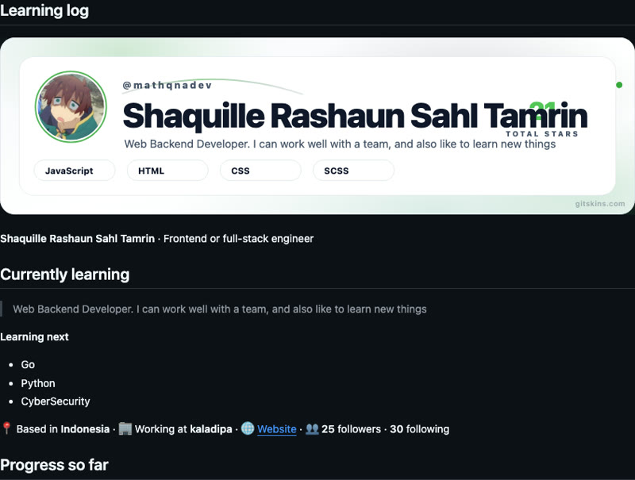</a>
      <br><b><a href="https://github.com/MathQnADEV">@MathQnADEV</a></b>
    </td>
    <td width="50%" valign="top">
      <a href="https://github.com/Shreyas850">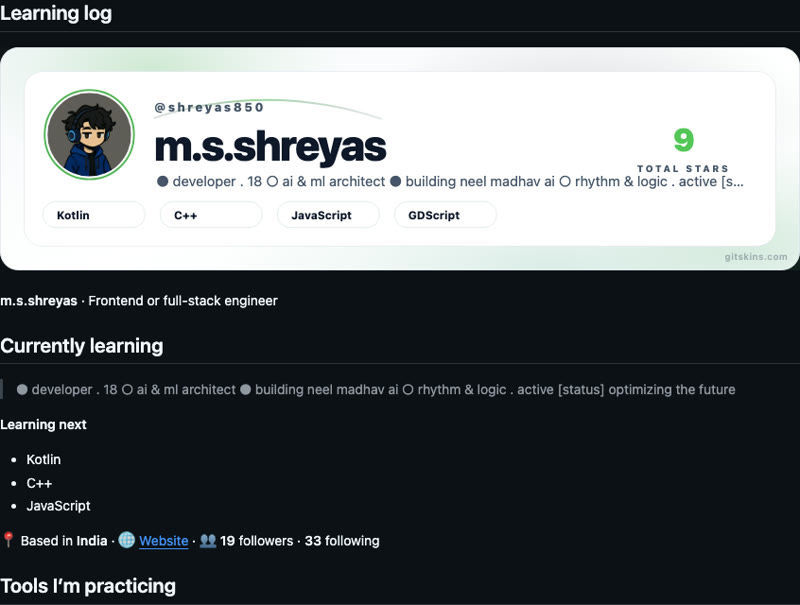</a>
      <br><b><a href="https://github.com/Shreyas850">@Shreyas850</a></b>
    </td>
  </tr>
  <tr>
    <td width="50%" valign="top">
      <a href="https://github.com/mahmoudfalous">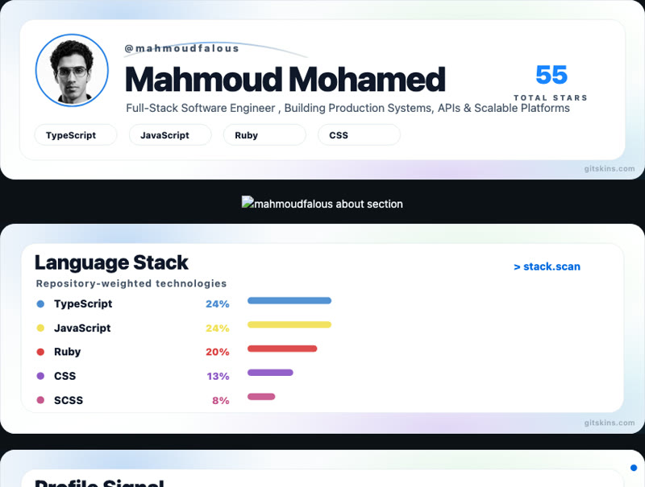</a>
      <br><b><a href="https://github.com/mahmoudfalous">@mahmoudfalous</a></b>
    </td>
    <td width="50%" valign="top">
      <a href="https://github.com/mamadhosein23">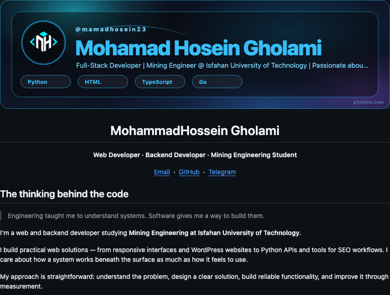</a>
      <br><b><a href="https://github.com/mamadhosein23">@mamadhosein23</a></b>
    </td>
  </tr>
</table>

## Playful visuals

Repo galaxies, contribution cities and tiny arcade games.

<table>
  <tr>
    <td width="50%" valign="top">
      <a href="https://github.com/sajjadjim">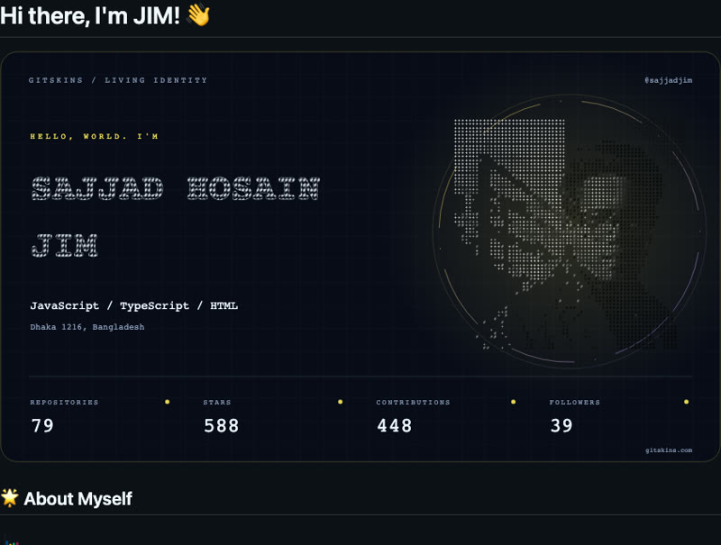</a>
      <br><b><a href="https://github.com/sajjadjim">@sajjadjim</a></b>
    </td>
    <td width="50%" valign="top">
      <a href="https://github.com/smangasmashntuli">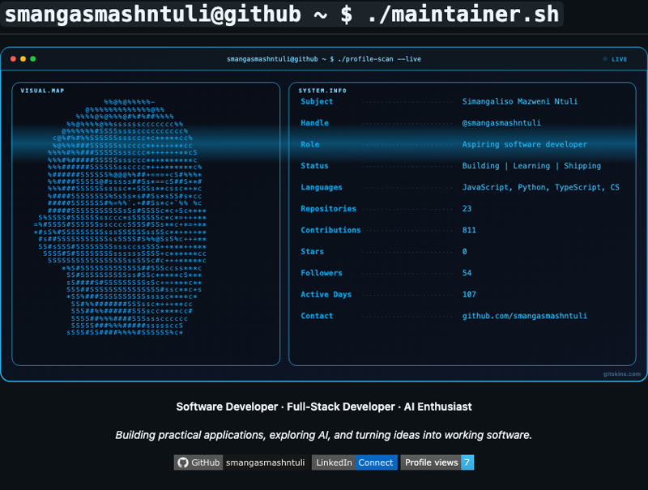</a>
      <br><b><a href="https://github.com/smangasmashntuli">@smangasmashntuli</a></b>
    </td>
  </tr>
  <tr>
    <td width="50%" valign="top">
      <a href="https://github.com/shouri123">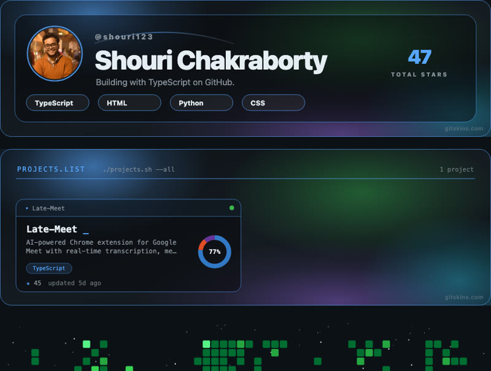</a>
      <br><b><a href="https://github.com/shouri123">@shouri123</a></b>
    </td>
    <td width="50%" valign="top">
      <a href="https://github.com/janfdev">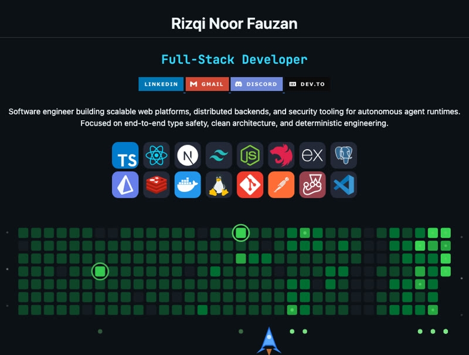</a>
      <br><b><a href="https://github.com/janfdev">@janfdev</a></b>
    </td>
  </tr>
</table>

## Get featured

Made something you're proud of with GitSkins? Open a pull request that adds your profile. See [CONTRIBUTING.md](CONTRIBUTING.md) for the steps. We look for profiles that:

- use GitSkins widgets or a GitSkins template on their profile README or portfolio,
- are finished, with no broken images or placeholder text,
- say something real about the person: their work, their projects, what they care about.

## Featured badge

If you're on this list, you're welcome to show it off in your README:

[](https://github.com/asamassekou10/awesome-gitskins)

```md
[](https://github.com/asamassekou10/awesome-gitskins)
```

## Remove your profile

Everything here is a public profile README, shown with a link and credit to its owner. If you'd rather not be listed, [open an issue](https://github.com/asamassekou10/awesome-gitskins/issues/new?title=Remove%20my%20profile) or a pull request that removes your entry, and we'll take it down right away, no questions asked.

## License

[](https://creativecommons.org/publicdomain/zero/1.0/)

The list itself is released under CC0. Each profile and its screenshot belong to its owner.
